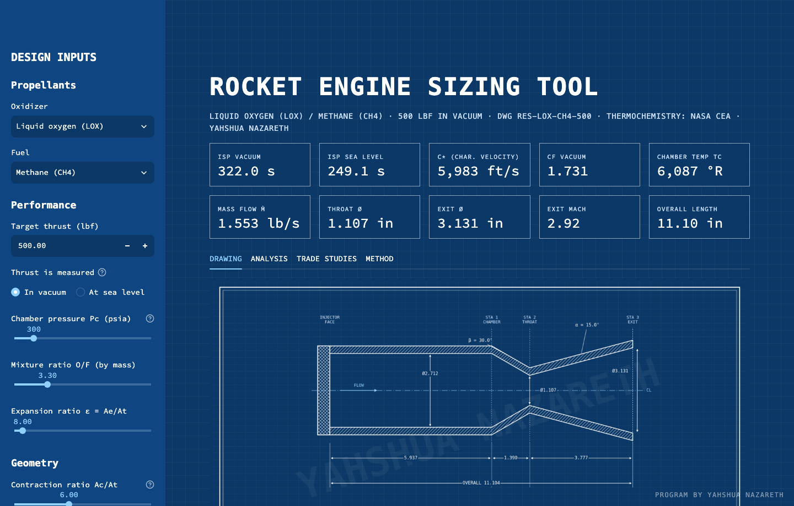
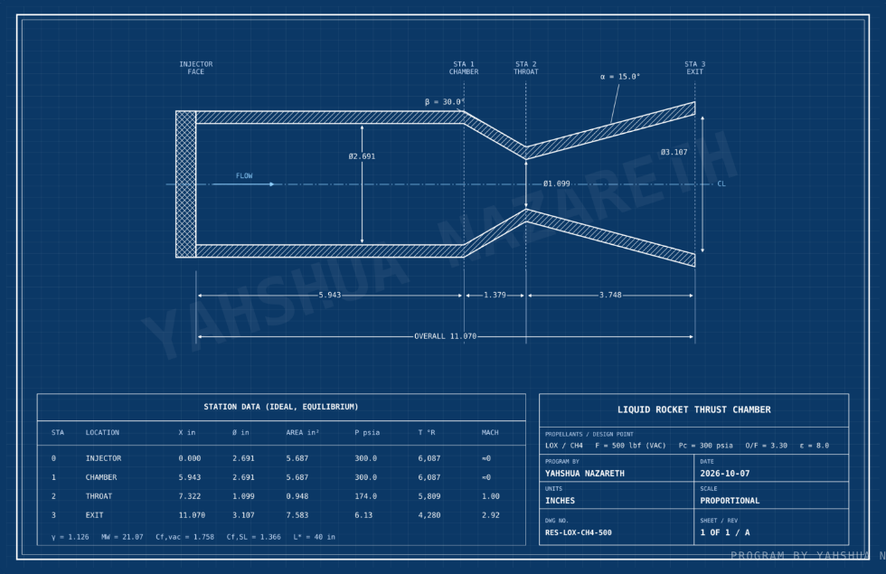

# Rocket Engine Sizing Tool

A desktop program for the preliminary sizing of small liquid rocket engines.
Choose the propellants, target thrust and chamber pressure, and it calculates
the propellant flow rates, the main thrust chamber dimensions and the gas
conditions through the engine, then produces a dimensioned engineering drawing
and trade studies on the key design choices.

Combustion properties come from NASA's CEA (Chemical Equilibrium with
Applications) program through the `rocketcea` Python library.

**Program by Yahshua Nazareth**, aerospace engineering student at San José
State University.



## Features

- **Propellants:** liquid oxygen or nitrous oxide, with methane, RP-1,
  hydrogen, ethanol or propane
- **Performance:** vacuum and sea-level specific impulse, characteristic
  velocity c\*, thrust coefficient, chamber temperature
- **Flow:** total, oxidizer and fuel mass flow rates
- **Geometry:** throat, exit and chamber diameters; chamber, converging and
  nozzle lengths
- **Station data:** pressure, temperature and Mach number at the chamber,
  throat and nozzle exit
- **Exhaust composition:** combustion products in the chamber and at the exit
- **Trade studies:** Isp, temperature and size against mixture ratio, chamber
  pressure and expansion ratio
- **Exports:** the drawing as PNG, the wall contour as CSV for CAD, and the
  full results as CSV



## Baseline design

| Input | Value |
|---|---|
| Propellants | LOX / methane |
| Thrust | 500 lbf (vacuum) |
| Chamber pressure | 300 psia |
| Mixture ratio (O/F) | 3.3 |
| Expansion ratio | 8 |

| Result | Value |
|---|---|
| Vacuum Isp | 322.0 s |
| Sea-level Isp | 249.1 s |
| Mass flow rate | 1.553 lb/s |
| Throat diameter | 1.107 in |
| Exit diameter | 3.131 in |
| Exit Mach number | 2.92 |
| Overall length | 11.10 in |

## Method

1. **Thermochemistry.** NASA CEA solves for the equilibrium combustion
   products and returns Isp, c\* and the gas properties at each station.
   CEA assumes the exhaust leaves perfectly straight back; in a conical nozzle
   it spreads over the wall angle α, so the divergence loss is removed:
   `λ = (1 + cos α) / 2`, `Isp = Isp_CEA − (1 − λ) · v_exit / g0`.
   At the baseline this lowers vacuum Isp from 327.0 s to 322.0 s.
2. **Mass flow.** Specific impulse is thrust per unit propellant flow, so
   `mdot = F / Isp`. The mixture ratio splits it into fuel and oxidizer:
   `mdot_fuel = mdot / (1 + O/F)`.
3. **Areas.** `At = mdot * c* / (Pc * g0)`, then `Ae = ε * At` and
   `Ac = (Ac/At) * At`. Each diameter is `D = 2 * sqrt(A / π)`.
4. **Lengths.** The converging and diverging walls are straight cones, so
   `L = (R2 - R1) / tan(angle)`. Chamber volume comes from the characteristic
   length: `Vc = L* * At`.
5. **Thrust coefficient.** `Cf = F / (Pc * At)` scores the nozzle on its own.
   Because the throat is sized from c\*, this is a consistency identity
   (`Isp = c* · Cf / g0`), not an independent check.

## Running it (macOS)

Requirements: Python 3.12 and a Fortran compiler for `rocketcea`.

```
brew install python@3.12 gcc
git clone <this repository>
cd rocket-sizing
python3.12 -m venv .venv
source .venv/bin/activate
pip install -r requirements.txt
python desktop.py
```

After setup, double-click **Rocket Engine Sizing Tool.app** in the project
folder. The program runs entirely on the local computer.

## Running it (Windows)

Requirements: Windows 10 or 11 and Python 3.12. No compiler is needed on
Windows: `rocketcea` installs ready-built.

1. Install Python 3.12 from [python.org](https://www.python.org/downloads/windows/).
   During setup, tick **Add python.exe to PATH**.
2. Download or clone this repository and open the folder.
3. Double-click **Start Rocket Sizing Tool (Windows).bat**.

The first launch creates a Python environment and installs the libraries,
which takes a few minutes. After that it opens straight into the app window.
If Windows SmartScreen warns about the file, choose **More info → Run anyway**.

The window uses Microsoft Edge WebView2, which is built into Windows 11 and
current Windows 10. If the window stays blank, install the
[WebView2 Runtime](https://developer.microsoft.com/microsoft-edge/webview2/).
Server messages are written to `app.log` in the project folder.

## Files

| File | Purpose |
|---|---|
| `engine.py` | All engineering calculations, with no interface code |
| `app.py` | The interface: inputs, drawing, tables and plots |
| `desktop.py` | Opens the interface in its own desktop window |
| `sizing.py` | The original step-by-step script the project started from |
| `requirements.txt` | Python libraries the program needs |
| `.streamlit/config.toml` | Blueprint colour theme |
| `Rocket Engine Sizing Tool.app` | macOS launcher |
| `Start Rocket Sizing Tool.command` | macOS launcher that shows the log in Terminal |
| `Start Rocket Sizing Tool (Windows).bat` | Windows launcher |

## Updates

When the app opens, it checks GitHub for a newer release and shows a notice
with a download link if there is one. Copies downloaded with `git clone`
update themselves each time the app opens (`git pull --ff-only`, which never
overwrites local changes).

To publish a release: change `VERSION` in `version.py`, commit, then push a
tag with the same number (for example `v1.1`). GitHub builds the downloads.

## Limitations

This is a first-pass sizing. It assumes equilibrium chemistry, and apart from
the conical nozzle's divergence loss it includes no losses (friction, heat
transfer, incomplete combustion). The nozzle is a sharp-cornered cone. It does
not cover cooling, wall thickness, injector design or structures. Real engines
typically achieve 90–97% of the ideal CEA Isp.

## Development

I derived the core sizing method (flow rates, throat, exit and nozzle length)
by hand. I used Claude, an AI assistant, as a mentor through those
derivations, and it wrote much of the code, including the interface and the
chamber, station-data and trade-study calculations.
